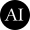
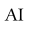
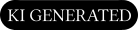
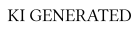
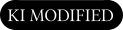
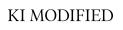

# EU-AI-Act-Symbole

| SVG  | Verwendung  |
|---|---|
|   | **Basic AI Icon "Grundlegendes KI-Symbol"** KI wurde bei der Erstellung eingesetzt  |
|   | **Fully KI Generated "Vollständig KI-generiert"**  Der Inhalt wurde komplett mit KI erzeugt |
|    | **Partially-Modified "Teilweise KI-verändert"** Bestehender Inhalt teilweise mit KI verändert |
